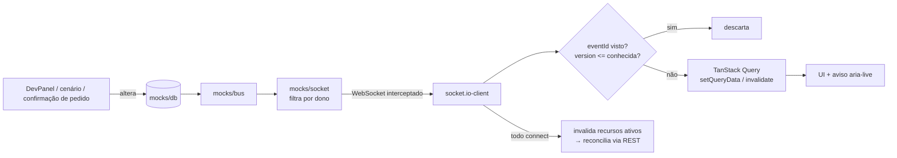
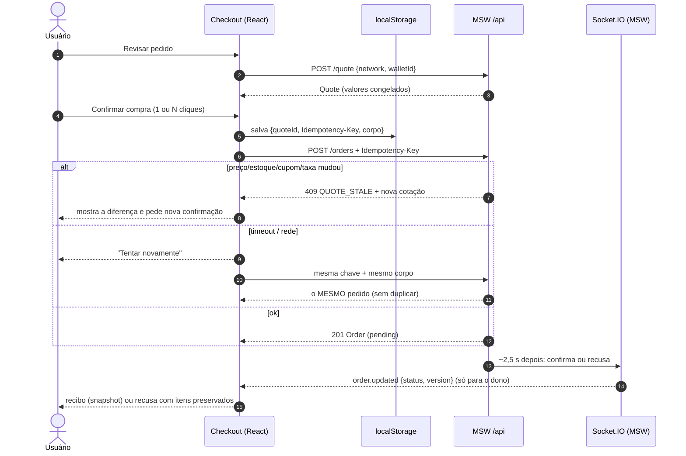

# Arquitetura — Kurio NFT Marketplace

## Visão geral

SPA em Vite + React 19 + TypeScript. Todo o "backend" (REST e Socket.IO) é simulado no browser pelo MSW, conforme o enunciado. O app não sabe que fala com um mock: as requisições saem pelo Axios e pelo `socket.io-client` e são interceptadas na camada de rede.

```
routes/ ─► components/ ─► hooks/ (TanStack Query) ─► services/ (chamadas tipadas) ─► api/client.ts (Axios)
                                   ▲                                                         │
                     realtime/useRealtimeSync ◄── socket.io-client ◄──┐                       ▼
                                                                    MSW (service worker + ws interceptor)
                                                                      └─ mocks/handlers ─► mocks/db (localStorage)
                                                                         mocks/socket  ◄── mocks/bus ◄──┘
schemas/ (Zod) — compartilhados por services, formulários e mocks
```

| Pasta | Responsabilidade |
| --- | --- |
| `src/api` | Instância Axios (baseURL, timeout 8 s, headers de sessão/visitante) e `ApiError` normalizado |
| `src/schemas` | Contratos Zod + tipos inferidos (fonte única para app e mocks) |
| `src/services` | Uma função por endpoint; valida a resposta com `schema.parse` |
| `src/hooks` | Query keys, queries, mutations, invalidação e otimismo |
| `src/realtime` | Conexão Socket.IO por sessão e aplicação dos eventos no cache |
| `src/mocks` | Backend simulado: banco, handlers REST, servidor Socket.IO, cenários, DevPanel |
| `src/routes` | Rotas file-based do TanStack Router; `_auth` protege as privadas |

## Contratos REST

Prefixo `/api`. Erros sempre em `{ "error": { "code", "message", "fields"?, "details"? } }`.

| Método e rota | Auth | Sucesso | Erros |
| --- | --- | --- | --- |
| `POST /auth/register` `{username,email,password,confirmPassword}` | — | 201 `{user, token}` | 409 `EMAIL_TAKEN`/`USERNAME_TAKEN`, 422 |
| `POST /auth/login` `{email,password}` | — | `{user, token}` | 401 `INVALID_CREDENTIALS` |
| `GET /auth/session` | sim | `{user}` | 401 `SESSION_EXPIRED` |
| `POST /auth/logout` | sim | 204 | — |
| `GET /nfts?q&collections&networks&minPrice&maxPrice&tab&sort&page&pageSize` | — | `{items,page,pageSize,total,totalPages,facets}` | 503 `TRANSIENT` |
| `GET /nfts/:id` | — | `Nft` (com `editions[]` e `version`) | 404 |
| `GET /favorites` · `PUT/DELETE /favorites/:nftId` | sim | `{nftIds}` | 500 (cenário) |
| `GET /cart` | visitante ou sim | `Cart` | — |
| `POST /cart/items` `{nftId,editionId,quantity}` | visitante ou sim | `Cart` | 409 `OUT_OF_STOCK` |
| `PATCH /cart/items/:id` `{quantity}` · `DELETE /cart/items/:id` | visitante ou sim | `Cart` | 404, 409 |
| `PUT /cart/coupon` `{code}` · `DELETE /cart/coupon` | visitante ou sim | `Cart` | 422 `COUPON_INVALID`/`COUPON_EXPIRED` |
| `POST /cart/merge` `{guestCartId}` | sim | `Cart` | — |
| `POST /quote` `{network,walletId}` | sim | `Quote` (valores congelados, expira em 10 min) | 409 `OUT_OF_STOCK`, 404 |
| `POST /orders` + `Idempotency-Key` `{quoteId,walletId,network,buyer}` | sim | 201 `Order` (`pending`) | 409 `QUOTE_STALE` (com `details.quote`), 409 `IDEMPOTENCY_CONFLICT`, 403 carteira desconectada |
| `GET /orders/:id` | sim (dono) | `Order` com `receipt` | 404 |
| `GET /profile` · `PATCH /profile` · `POST /profile/password` | sim | `Profile` / 204 | 409, 422 |
| `GET /wallets` · `POST /wallets` · `PATCH /wallets/:id` | sim | `{wallets}` / `Wallet` | 409, 422 |
| `POST /wallets/:id/connect` · `/disconnect` | sim | `Wallet` | 403 `WALLET_REJECTED` |

Visitante é identificado pelo header `X-Guest-Cart: <uuid>` (gerado no cliente). Autenticado usa `Authorization: Bearer <token>`.

**Servidor autoritativo:** o cliente envia intenções (ids, quantidades, código de cupom). Preços, descontos, taxas, totais e status são sempre calculados pelo servidor. O `POST /orders` não recebe valores.

## Eventos Socket.IO



Envelope comum: `{ eventId, type, resource: { type, id }, version, occurredAt, data }`.

| Evento | Destino | `data` | Efeito no cliente |
| --- | --- | --- | --- |
| `nft.updated` | todos | `{ editions: [{id, price, available}] }` | Atualiza o detalhe, invalida listas e o carrinho; toast se o NFT está no carrinho |
| `order.updated` | só o dono | `{ status }` | Atualiza o pedido; terminal → invalida carrinho e limpa tentativa pendente |

- **Duplicatas e eventos antigos:** o cliente guarda os `eventId` vistos e a maior `version` por recurso (comparando também com a versão em cache). Evento repetido ou com `version <=` à conhecida é descartado sem efeitos.
- **Conexão e reconexão:** em todo `connect`, o cliente invalida catálogo, detalhes, carrinho e pedidos cujo dado é anterior ao handshake (reconciliação REST). Cobre a queda e a janela entre o primeiro fetch e a primeira conexão.
- **Sessões:** o socket é recriado a cada troca de usuário com o token da sessão; o cleanup remove listeners e desconecta. O servidor só entrega `order.updated` para conexões cujo token pertence ao dono do pedido.

### Transporte nos mocks e limitações

- `@mswjs/socket.io-binding` sobre `ws.link('wss://realtime.kurio.mock/*')`.
- Só WebSocket (`transports: ['websocket']`): o MSW intercepta WebSocket, não long-polling.
- O binding responde o handshake sozinho e ignora o payload `auth` do CONNECT; por isso o token vai na **query** da conexão.
- O binding não envia ping do Engine.IO; o servidor simulado envia `"2"` a cada 20 s para o cliente não encerrar a conexão.
- O `engine.io-client` captura `globalThis.WebSocket` no import. Por isso `main.tsx` inicia o MSW **antes** de importar a aplicação, e o `socket.io-client` é carregado sob demanda (`realtime/socket.ts`).
- O `io()` reaproveita o Manager em cache para a mesma URL; cada sessão usa `forceNew: true` para não herdar a query (token) da anterior.
- O "servidor" vive na aba: duas abas compartilham o `localStorage` (sincronizado pelo evento `storage`), mas cada aba tem seu próprio emissor de eventos.

## Sessão

- Token opaco em `localStorage`, expiração de 30 min (20 s no cenário `session-expired`).
- `GET /auth/session` no boot recupera a sessão após refresh.
- Qualquer 401 com token enviado dispara `sessionEvents.emitExpired()`: limpa o cache, avisa o usuário e, se a rota atual é privada, redireciona para `/login?redirect=<rota atual>`. O formulário de pagamento é salvo em `sessionStorage` para retomada.
- Logout e troca de usuário: `queryClient.clear()` + socket recriado. Query keys privadas incluem o `userId`.
- `redirect` aceita apenas caminhos internos (proteção contra open redirect).

**Em produção** (fora do escopo do mock): BFF com sessão em cookie `httpOnly; Secure; SameSite=Lax`, token CSRF nas mutations e segredos de gateway somente no servidor. O service worker do MSW não consegue emitir cookies `httpOnly`, por isso o mock usa Bearer.

## Carrinho

- Mantido no servidor (mock) por dono: `user:<id>` ou `guest:<uuid>`. Sobrevive a refresh.
- No login/cadastro, `POST /cart/merge` soma o carrinho do visitante ao do usuário (limitado à disponibilidade) e o id de visitante é descartado.
- Cada mutation retorna o carrinho recalculado e o cache recebe exatamente essa resposta (sem cálculo no cliente).
- `priceChanged`/`previousUnitPrice` indicam alteração de preço desde que o item entrou no carrinho.

## Checkout e pedidos



1. "Revisar" → `POST /quote` congela itens, preços, cupom e taxa da rede escolhida.
2. "Confirmar" → `usePlaceOrder` gera **uma `Idempotency-Key` por cotação** e grava `{quoteId, key, corpo}` em `localStorage` antes do envio.
3. Clique repetido, timeout ou refresh reenviam a mesma chave com o mesmo corpo → o servidor devolve o mesmo pedido. Mesma chave com corpo diferente → 409.
4. Se preço, estoque, cupom ou taxa mudaram desde a cotação → 409 `QUOTE_STALE` com a nova cotação; a UI mostra a diferença e exige nova confirmação (nova cotação = nova chave).
5. Pedido nasce `pending`; o mock resolve em ~2,5 s, emite `order.updated` e, na confirmação, debita a disponibilidade e remove do carrinho **apenas** os itens e quantidades comprados. Pendentes são reagendados ao recarregar a página.
6. O recibo é um snapshot da cotação: mudanças posteriores no catálogo não o alteram.

## Cache, retries e sincronização

| Dado | staleTime | Observação |
| --- | --- | --- |
| Catálogo (`['nfts', params]`) | 30 s | `keepPreviousData`; `signal` cancela a requisição anterior; cada combinação de filtros é uma chave |
| Detalhe (`['nft', id]`) | 30 s | Atualizado por `nft.updated` |
| Sessão | 5 min | Invalidada em login/logout/expiração |
| Carrinho, pedido | 0 | Sempre revalidados; atualizados por eventos |

- Retries: queries repetem até 2× apenas falhas transitórias (rede, timeout, 5xx), com backoff exponencial. 4xx nunca. Mutations não repetem automaticamente; o pedido usa retry manual idempotente.
- Respostas fora de ordem: cada resposta vai para a chave dos parâmetros que a geraram, e a requisição obsoleta é abortada via `AbortSignal`.
- Atualização otimista: favoritos (`onMutate` + rollback em `onError` + revalidação em `onSettled`).

## Mocks e cenários

- O MSW fica ativo por padrão (dev, build publicado, CI); `VITE_ENABLE_MOCKS=false` desliga para um backend real.
- Banco em `localStorage['kurio:db']`; `reset()` restaura o seed determinístico (PRNG com seed fixa).
- Cenários: `?scenario=<id>` (persistido) ou DevPanel. Lista em `src/mocks/scenarios.ts` e no README.
- `window.__kurioMock` expõe controles do servidor (alterar preço, esgotar, derrubar socket, expirar sessão, duplicar/enviar evento antigo). Todos agem no `db` e emitem pelo transporte Socket.IO — nunca no cache da UI.

## Decisões de UX e desvios do Figma

Decisões completas (com alternativas e custos) em [docs/DECISIONS.md](docs/DECISIONS.md). Bugs encontrados na verificação em [docs/BUGS.md](docs/BUGS.md).

**Fora do escopo, sem simular sucesso.** Login social mantém o visual do Figma e responde com um aviso (toast) ao clique, sem fingir autenticação. "Esqueceu a senha?", newsletter, blog, Criadores, Aprenda, compartilhamento e itens do menu de perfil (Atividade, Lista de interesse, Ofertas, Arquivos, Suporte) aparecem desabilitados com "Em breve", acessíveis (`aria-disabled` + texto para leitores de tela).

**Desvios do Figma:**

| Tela | Desvio | Motivo |
| --- | --- | --- |
| Início (desktop) | Busca na lupa do header, que expande um campo inline | O Figma desktop não tem campo de busca, mas o enunciado exige; a lupa já existe no frame, então a barra de abas fica idêntica |
| Início | Grade de 2 colunas em 768 px (3 a partir de 1024) | Evitar cards comprimidos no tablet |
| Início | Loading troca os cards por skeletons em toda request nova (filtro, página, busca) | O enunciado pede skeletons nos componentes dependentes de dados; manter os cards antigos com um aviso discreto deixava o carregamento invisível |
| Início | Preço do card = edição 1/50 | Igual ao detalhe e ao Figma (1.19 ETH); evita card e detalhe com preços diferentes |
| Detalhe | "Mais desta coleção" com 3 cards (Figma: 5) | Só mostra NFTs da mesma coleção; o mock tem 3 outros por coleção, completar com outras coleções contradiria o título |
| Detalhe | Ícones de compartilhamento genéricos | `lucide-react` 1.x não tem ícones de marca; compartilhamento está fora do escopo |
| Detalhe/Carrinho/Pagamento (mobile) | Sem tab bar inferior | Os frames mobile dessas telas têm barra de ação própria |
| Carrinho | Linha mostra edição e subtotal | Necessário para distinguir edições do mesmo NFT |
| Pagamento | Fluxo em duas etapas (Revisar → Confirmar) | O enunciado exige revisão antes do envio e revalidação da cotação |
| Pagamento | Campos de rede, endereço, tipo, ENS e indicação vêm da carteira escolhida | Pertencem à carteira cadastrada; editar soltos no checkout geraria divergência com o servidor |
| Pagamento (mobile) | Layout derivado do desktop | O frame mobile não pôde ser exportado (limite da API do Figma); segue o padrão do carrinho mobile |
| Confirmação | Tela própria com o card de 578 px | Garante acesso direto e refresh ao recibo |
| Perfil | Igual ao Figma: um único "Salvar" | Envia perfil e/ou senha só se mudaram; cada erro da API volta para o campo da request que falhou, e o toast diz o que foi salvo |
| Carteiras | Igual ao Figma: formulário direto, já preenchido | Status de conexão discreto ao lado do título; "Igual à carteira principal" pré-preenche a secundária |
| Login/Cadastro (desktop) | Modal sobre a página atual (`?auth=login\|signup`) | Fechar só remove o parâmetro; em `/login` (guards, sessão expirada) o fundo é herói + catálogo e fechar nunca volta a uma rota protegida |
| Login/Cadastro (mobile) | Botão fechar (X) | A tela é um diálogo em tela cheia com foco contido; precisa de saída |
| Tablet (768) | Herói e destaques do footer em escala intermediária | O Figma só tem 1440 e 414; as medidas fixas do desktop não cabem em 768 |

**Outros detalhes:**
- Arrays nos search params seguem a serialização JSON do TanStack Router (`?collections=["music"]`), que mantém tipos e round-trip.
- Fonte Roboto Mono self-hosted via `@fontsource-variable/roboto-mono`.
- As imagens dos NFTs são as 4 artes originais do Figma, exportadas em WebP 640/1080 px.
